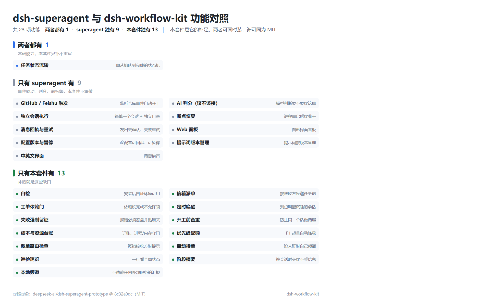

# 功能对照：dsh-superagent 与 dsh-workflow-kit

本套件是 [dsh-superagent](https://github.com/deepseek-ai/dsh-superagent-prototype)（MIT）的**补足**：它做的事我们不重做，它没做的我们补上。

✓ = 有　✗ = 没有

| 功能 | 说明 | superagent | 本套件 |
|---|---|:---:|:---:|
| GitHub / Feishu 触发 | 监听仓库事件自动开工 | ✓ | ✗ |
| 任务状态流转 | 工单从排队到完成的状态机 | ✓ | ✓ |
| AI 判分（该不该接） | 模型判断要不要接这单 | ✓ | ✗ |
| 独立会话执行 | 每单一个会话 + 独立目录 | ✓ | ✗ |
| 断点恢复 | 进程重启后接着干 | ✓ | ✗ |
| 消息回执与重试 | 发出去确认、失败重试 | ✓ | ✗ |
| Web 面板 | 图形界面看板 | ✓ | ✗ |
| 配置版本与暂停 | 改配置可回滚、可暂停 | ✓ | ✗ |
| 提示词版本管理 | 提示词按版本管理 | ✓ | ✗ |
| 中英文界面 | 两套语言 | ✓ | ✗ |
| 自检 | 安装后自证环境可用 | ✗ | ✓ |
| 信箱派单 | 按接收方投递任务信 | ✗ | ✓ |
| 工单依赖门 | 依赖没完成不允许领 | ✗ | ✓ |
| 定时唤醒 | 到点叫醒沉睡的会话 | ✗ | ✓ |
| 失败强制留证 | 报错必须落盘并贴原文 | ✗ | ✓ |
| 开工前查重 | 防止同一个活做两遍 | ✗ | ✓ |
| 成本与资源台账 | 记账、进程/内存守门 | ✗ | ✓ |
| 优先级配额 | P1 超量自动降级 | ✗ | ✓ |
| 派单路由检查 | 派错接收方时提示 | ✗ | ✓ |
| 自动接单 | 没人盯时自己领活 | ✗ | ✓ |
| 巡检速览 | 一行看全局状态 | ✗ | ✓ |
| 阶段摘要 | 换会话时交接不丢信息 | ✗ | ✓ |
| 本地频道 | 不依赖任何外部服务的汇报 | ✗ | ✓ |
| 许可 | 开源协议 | MIT | MIT |

## 怎么配合用

- **superagent**：管一个仓库的自主开发（收事件 → 建单 → 起会话 → 开 PR）。
- **本套件**：管人和接收方之间的分发（谁干、干完没、卡没卡、什么时候叫醒、花了多少）。

两者都只写本地文件，`workspace` 不指向同一目录就不冲突，可以同时装。

## 本套件补的 12 项，对应到命令

| 功能 | 命令 / 文件 |
|---|---|
| 信箱派单 | `bin/take.mjs`、`tasks/mailbox/` |
| 工单依赖门 | `bin/wo.mjs take`（`deps` 未完成即拒） |
| 定时唤醒 | `docs/02-巡检prompt.md` |
| 失败强制留证 | `lib/fail-hook.mjs`、`bin/wo.mjs block` |
| 开工前查重 | `docs/01` |
| 成本与资源台账 | `docs/03` |
| 优先级配额 | `bin/wo.mjs list`（超量降 P2） |
| 派单路由检查 | `bin/routing-guard.mjs` |
| 自动接单 | `bin/autotake.mjs` |
| 巡检速览 | `bin/patrol.mjs --quiet`（约定见 docs/02） |
| 阶段摘要 | `docs/03` |
| 本地频道 | `bin/say.mjs`、`bin/progress.mjs`、`data/channel.jsonl` |
